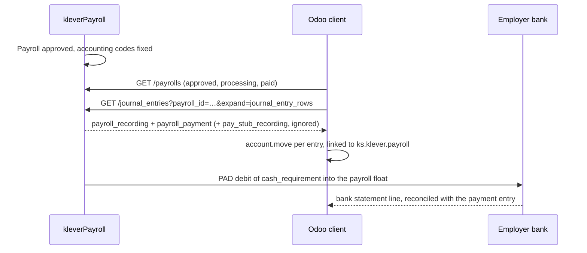

# Accounting in kleverPayroll

The single place for accounting in the kleverPayroll Odoo integration: what the GL sync must do,
decisions, the entries it produces, and the open questions. Other documents and tasks link here
instead of holding their own copy.

- How it is built: [GL journal entries sync — specification](specs/gl-journal-entries-sync.md).
- What the API does: [klever_api/](klever_api/README.md).
- The analysis session of 4 Nov this document started from:
  [archive/2026-11-04-gl-sync-discussion.md](archive/2026-11-04-gl-sync-discussion.md).

## 1. The task as received

Integrate the kleverPayroll General Ledger with Odoo Accounting: after payroll processing, retrieve
GL data from kleverPayroll and create journal entries in Odoo.

| # | Requirement |
| --- | --- |
| R1 | Retrieve GL data via the API |
| R2 | Use the Accounting Information configured in kleverPayroll |
| R3 | Map kleverPayroll GL accounts to `account.account` |
| R4 | Create `account.move` with debit/credit lines |
| R5 | Link journal entries to the relevant Payroll / Pay Run |
| R6 | Prevent duplicates on repeated sync |
| R7 | Handle sync errors and log results |

Condition: GL data can be extracted only if Accounting Information is properly configured.

Acceptance: GL imported; entries balanced; no duplicates on re-sync; users see sync status and errors.

Questions raised in the task itself: GL API structure, sync trigger, account mapping rules, draft or
posted. The API structure is answered in [klever_api/](klever_api/README.md); the rest are below.

## 2. How a pay run reaches the GL

kleverPayroll computes the payroll and its accounting result; Odoo receives only the finished result.
(Odoo Enterprise `hr_payroll_account` does the same for native Odoo payroll, which is why it must not
run next to this sync: see [D6](#3-decisions).)

*One payroll gives two Odoo journal entries: the accrual and the payment.*

## 3. Decisions

Nothing is decided yet. Rows marked **Proposed** are drafts by Dan and his agent. Each one is decided
by its owner — Mariana for accounting, Hatem for payroll — with Dan's help; the owner then changes the
status to **Decided** (or rewrites the row). The spec is built with the proposals as defaults until
then.

| # | Date | Status | Decision | Question |
| --- | --- | --- | --- | --- |
| D1 | 4 Nov | Proposed | Import only `payroll_recording` and `payroll_payment`, never `pay_stub_recording` (it would double-count) | — (follows from the vendor docs) |
| D2 | 4 Nov | Proposed | Import only payrolls in `approved`, `processing` or `paid`; never `draft` or `failed` | [Q16](#q16-failed-payrolls) |
| D3 | 4 Nov | Proposed | One Odoo `account.move` per kleverPayroll journal entry; the vendor entry id is the duplicate key | — |
| D4 | 4 Nov | Proposed | An entry is imported only when it is balanced, carries no validation flag, and every row code maps to an Odoo account. Otherwise it is logged as an error and nothing is booked. No balancing or suspense line is ever invented | [Q7](#q7-account-mapping) |
| D5 | 4 Nov | Proposed | Imported entries are created in draft; a per-company "Auto-post" option posts them | [Q1](#q1-draft-or-posted) |
| D6 | 7 Nov | Proposed | The GL sync lives in a new bridge module `ks_klever_payroll_account`, so the client module keeps working without Accounting. It refuses to run while Odoo's `hr_payroll_account` is installed, because Odoo would book the same payroll a second time from the payslips | [Q17](#q17-odoo-payroll-accounting) |
| D7 | 4 Nov | Proposed | Once an entry is imported, the sync never changes or recreates it, even if it is edited or deleted in Odoo. Corrections go through kleverPayroll correction payrolls | [Q15](#q15-changes-after-import) |
| D8 | 4 Nov | Proposed | Segment templates, analytic distribution, EHT, WCB and vacation accrual are out of the first version | [Q10](#q10-departments-and-analytics), [Q11](#q11-items-outside-payroll-entries) |
| D9 | 4 Nov | Proposed | The Odoo chart of accounts can be pushed into kleverPayroll as accounting codes, so codes match by construction. Phase 2, after the pull sync works | [Q7](#q7-account-mapping) |

## 4. Entries

Illustrative numbers, made up. Accounts are working names; Mariana sets the real ones.

**Payroll recording** (accrual), dated on the pay date by default ([Q18](#q18-entry-dates)):

| Account | Dr | Cr |
| --- | ---: | ---: |
| Wages Expense | 10,000.00 | |
| Employer CPP Expense | 550.00 | |
| Employer EI Expense | 230.00 | |
| Income Tax Payable | | 1,800.00 |
| CPP Payable (550 employee + 550 employer) | | 1,100.00 |
| EI Payable (164 employee + 230 employer) | | 394.00 |
| Net Pay Payable | | 7,486.00 |
| **Total** | **10,780.00** | **10,780.00** |

**Payroll payment**, dated on the debit date by default ([Q18](#q18-entry-dates)) — the vendor
debits the employer's bank once for `cash_requirement`:

| Account | Dr | Cr |
| --- | ---: | ---: |
| Income Tax Payable | 1,800.00 | |
| CPP Payable | 1,100.00 | |
| EI Payable | 394.00 | |
| Net Pay Payable | 7,486.00 | |
| Bank (the account the vendor debits) | | 10,780.00 |

After both entries every payroll liability is zero and the bank line of 10,780.00 is open for
reconciliation with the statement. For that, the vendor's bank code must map to the bank journal's
**Outstanding Payments** account (or a reconcilable payroll clearing account), not to the bank account
itself: otherwise the imported statement line books the same debit a second time
([spec §7.4](specs/gl-journal-entries-sync.md#74-the-bank-side-and-reconciliation)). Whether the vendor's payment entry really has this shape is
sandbox check 4 ([task](tasks/2026-11-07-gl-sandbox-checks.md)).

## 5. Open questions

Each question has an owner who answers it, with Dan explaining the system where needed
([task of 7 Nov](tasks/2026-11-07-gl-team-review.md)). Several answers are per client company (draft
or posted, start date, journal): the spec builds those as settings, and the owner decides the
default.

| Owner | Questions | Also owns |
| --- | --- | --- |
| Mariana (accounting) | Q1, Q3, Q6, Q7, Q9, Q10, Q15, Q16, Q18 | Decisions D3–D9, the entries in §4, spec §5, §7, §8 |
| Hatem (payroll) | Q4, Q5, Q11, Q12, Q16 | Decisions D1, D2, the line item / statutory types, the payroll statuses |
| Dan | Q2, Q8, Q13, Q14, Q17 | Architecture and the rest of the spec |

Q16 is shared: Hatem says what a failed payroll means, Mariana what the books should do about it.
Q19–Q20 are answered by the [sandbox checks](tasks/2026-11-07-gl-sandbox-checks.md).

### Q1. Draft or posted

Should imported journal entries stay in draft for the accountant's review, or be posted
automatically? Proposal: draft by default, with a per-company "Auto-post" option.

### Q2. Trigger

Automatic (scheduled, e.g. hourly or daily) after payroll approval, a manual "Sync now", or both?
Proposal: both — an hourly scheduled action and a button.

### Q3. Start date and history

From which pay date should payrolls be imported? Are earlier periods already in the GL from a
previous payroll provider? Proposal: a required "Sync payrolls paid from" date per company; nothing
before it is imported.

### Q4. Historical payrolls

Should payrolls of type `historical` ever be imported, or always skipped (they usually duplicate data
already in the GL)? Proposal: skipped, with a per-company switch.

### Q5. Off-cycle and correction payrolls

Import them as separate journal entries like regular ones — please confirm.

### Q6. Payment entry and bank

We plan to import both the accrual and the payment entry (Dr liabilities / Cr bank), as the vendor's
Xero/QuickBooks export does. Is the payroll bank debit then reconciled in Odoo against this entry?
Which Odoo bank journal and account represent the account the vendor debits?

### Q7. Account mapping

Will the codes configured in kleverPayroll match the Odoo account codes exactly (e.g. `5000` =
`5000`)? Or do you need a mapping screen in Odoo? Should Odoo push its chart of accounts into
kleverPayroll so the codes always match? Proposal: match by code automatically, with a mapping screen
to override; the push in phase 2.

### Q8. Who configures accounting in kleverPayroll

Codes, rules, default bank and payroll payable accounts — the client company's accountant, or us
during onboarding?

### Q9. Journal

Which Odoo journal should hold payroll entries — a dedicated "Payroll" journal per company?
Proposal: a miscellaneous journal chosen per company; the module creates none by itself.

### Q10. Departments and analytics

Do you need payroll costs split by department, location or project in Odoo (analytic accounts)? The
row reference shows no tag data, but the vendor overview says rows carry tags as tracking dimensions
([conflict](klever_api/accounting-overview.md#conflict-tags-on-journal-entry-rows), sandbox check 6).
Until that is settled this is not in the first version.

### Q11. Items outside payroll entries

Vacation pay accrual (earned, not yet paid), Employer Health Tax (EHT) and WCB premiums are most
likely not part of the payroll journal entries. Confirm they are out of scope and recorded by the
accountant separately.

### Q12. Contractors

Contractor pay appears in payroll totals. Should it go into the same entries, as the vendor generates
them — confirm no separate treatment is expected.

### Q13. Errors and visibility

Who must see sync status and errors (accounting group only, payroll admins)? Should failures notify
someone (activity, email), or is a status list enough? Proposal: accountants and payroll managers see
the list; a failed entry posts a message on the payroll and an activity to the "Responsible" set per
company.

### Q14. Multi-company

One kleverPayroll Business Entity per Odoo company — confirm. (The client already allows several
Business Entities per configuration; each BE belongs to one Odoo company.)

### Q15. Changes after import

If an imported entry is edited or deleted in Odoo, should the next sync recreate it, or leave it
alone? Proposal: never recreate once imported; corrections go through kleverPayroll correction
payrolls.

### Q16. Failed payrolls

A payroll can end in `failed` (the payment failed). If its recording entry was already imported while
it was `approved`/`processing`, what should happen in Odoo — reverse it, or wait for the accountant?
Proposal: never reverse automatically; flag the imported entries of a failed payroll on the sync list.

### Q17. Odoo Payroll Accounting

Is Odoo's own `hr_payroll_account` (Payroll → accounting entries from payslips) used on any client
database? It must be uninstalled for the kleverPayroll GL sync, or the same payroll is booked twice.

### Q18. Entry dates

Which accounting date should each entry get? Proposal: the pay date for the recording entry and the
debit date for the payment entry, so the payment entry falls on the day the bank statement shows the
debit. The vendor's `posted_on` is not used: its reference describes it as the date the entry was
posted to the accounting system, i.e. the Xero/QuickBooks export
([journal entries](klever_api/journal-entries.md#entry-fields)).

### Q19. Amount format (sandbox)

Are row amounts in dollars or in cents, and can a row be negative? The spec treats a negative amount
as an error until this is known.

### Q20. Code when the accounting code has no number (sandbox)

What does a row's `code` hold when the kleverPayroll accounting code has only a title? The spec
treats an empty code as an error until this is known.
