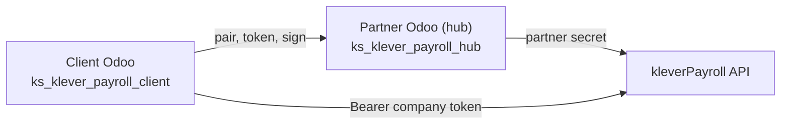
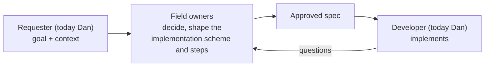

# kleverPayroll for Odoo

**The single source of truth** for the kleverPayroll Odoo integration: what we build, the
architecture, the team, the topics we work on, product decisions and open questions. A large topic
keeps its own decisions in its own file (see [Topics](#3-topics)).

This repository is the long-term home of all kleverPayroll development work, not of one task.
Accounting is the first topic; the next ones are added the same way.

## 1. What we build

kleverPayroll is Canadian payroll run by the kleverPayroll API. Kodershop builds the Odoo 19 side:
employees, pay schedules, pay runs and the embedded kleverPayroll component inside Odoo, and now the
import of the payroll's accounting into Odoo Accounting.

The product runs on **two separate Odoo instances**:

*The client does all day-to-day API work itself; the hub exists so the partner secret never reaches a
client company's instance.*

| Part | Repository | Odoo modules |
| --- | --- | --- |
| Client (the client company's Odoo) | `klever_payroll_19` (Azure DevOps) | `ks_klever_payroll_client`, `ks_klever_payroll_employee`, `ks_hr_employee_firstname`; planned `ks_klever_payroll_account` |
| Partner / hub (our Odoo) | `klever_payroll_hub_19` (Azure DevOps) | `ks_klever_payroll_hub` |
| Context (this repository) | `kodershop_context_klever_payroll` (GitHub) | — |

Pairing, the wire protocol between client and hub, and the code rules are documented in the code
repositories and in the Kodershop workspace; this repository does not repeat them.

**Plan:** move all development into this setup — a Claude Code on the web environment with this
repository and the code repository connected side by side, so every session sees both the context and
the code. Claude Code on the web works with GitHub repositories, so the code repositories need a
GitHub home (moved or mirrored from Azure DevOps) first; until then, code questions go to Dan.

## 2. Team

| Person | Role | Decides |
| --- | --- | --- |
| Dan | Project lead, senior developer, architect. Today the requester of every topic: sets the goal, fills this repository with context, helps the field owners understand the system and decide, then implements | Architecture, Odoo implementation, the product outside payroll and accounting |
| Hatem | Canadian payroll guru; builds the kleverPayroll module together with Dan | Payroll: pay runs, payroll types and statuses, statutory withholdings (CPP, CPP2, EI, income tax, RQ), vacation pay, EHT, WCB, ROE, year-end; what kleverPayroll does with a payroll |
| Mariana | Accountant | Accounting: chart of accounts, entries, accounts and dates, reconciliation, what the GL must show |
| Dmytro | CTO | Technical direction, priorities, final technical sign-off |

### How we work

Every topic follows the same cycle. The goal is a development task so clear that the developer (and
their agent) can implement it without guessing, and that matches how the owners of the fields it
touches see them — Hatem for payroll, Mariana for accounting.

*The requester brings the context and helps; the field owners own the decisions and the resulting
scheme; the developer builds it.*

- The requester's agent writes **drafts**: proposed decisions, questions and a first spec. A draft is
  a starting point, never a decision.
- The field owners correct the drafts, decide, and turn the spec into the implementation scheme and the
  steps they want built. The requester joins every discussion to explain the system and what is
  possible.
- A decision is recorded only when its owner (column *Decides* above) has made it.

Everyone works in this repository through Claude Code (on the web or locally), following
[AGENTS.md](AGENTS.md). `created_by` and `assigned_to` in tasks hold each person's full git
`user.name`; it is fixed the first time that person commits here.

## 3. Topics

A topic is one area of work with its own decisions, questions and specs. A large topic gets its own
file `<TOPIC>_kleverPayroll.md` (the only place for its decisions and questions), a section in the
[Roadmap](ROADMAP_kleverPayroll.md) and one spec per feature in `specs/`. A small one lives in this
file.

| Topic | Status | Requester | Field owners | Where |
| --- | --- | --- | --- | --- |
| Accounting — import payroll journal entries into Odoo (GL sync) | Active, since 4 Nov 2026 | Dan | Mariana, Hatem | [Accounting](ACCOUNTING_kleverPayroll.md), [spec](specs/gl-journal-entries-sync.md) |

## 4. Decisions

Decisions outside accounting. A decision goes in only when its owner (see [Team](#2-team)) has made it.

| Date | Decision |
| --- | --- |
| — | The product name is written **kleverPayroll** in every user-visible text (code repository rule, branch 1.23.1) |
| — | No vendor name in any identifier, string or doc inside `klever_payroll_19` |

## 5. Open questions

None outside accounting yet.
