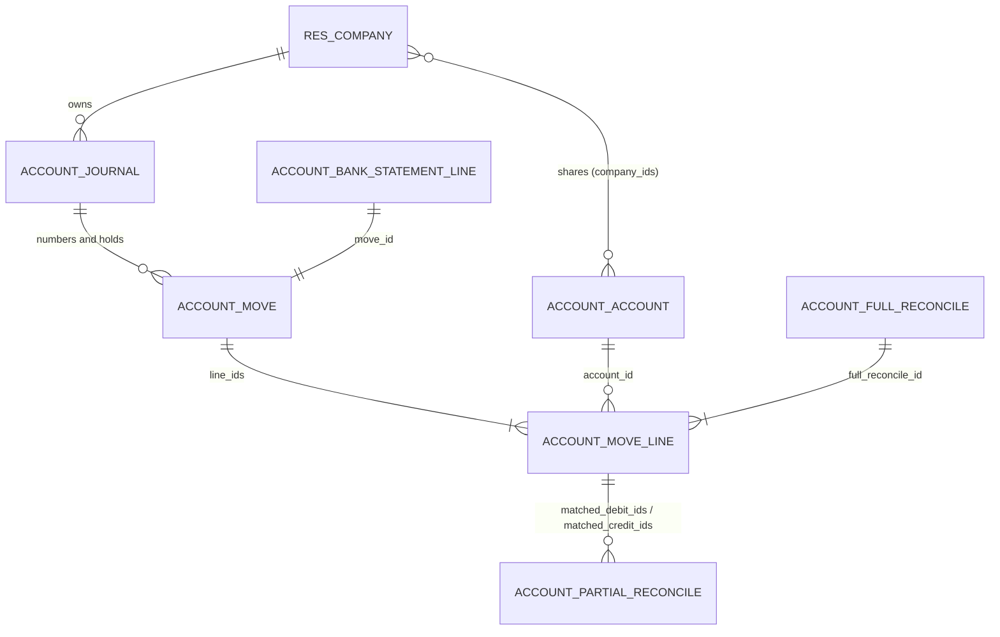
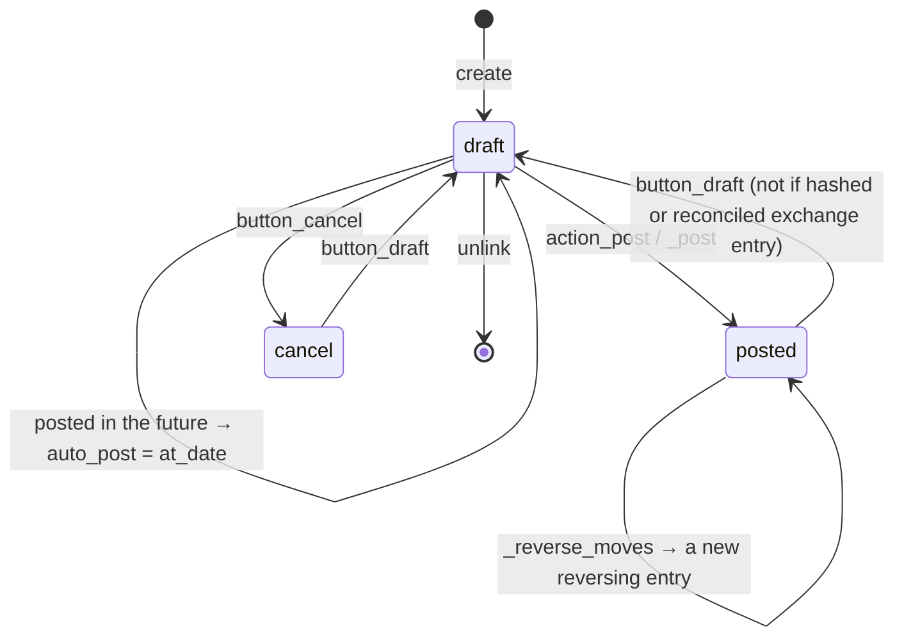

# The Odoo accounting model

How Odoo 19 stores and protects accounting data, as far as the kleverPayroll GL sync touches it. Read
from the `account` module, release 19.0.20260731; each section names the file and method in
[source/account/models/](source/README.md).

## 1. The models at a glance

*A journal entry (`account.move`) belongs to one journal and holds journal items (`account.move.line`), each on one account; reconciliation links items to each other.*

| Model | Odoo name in the UI | Role |
| --- | --- | --- |
| `account.account` | Account | One line of the chart of accounts |
| `account.journal` | Journal | Where entries are recorded and numbered: Sales, Purchase, Bank, Cash, Credit Card, Miscellaneous |
| `account.move` | Journal Entry (also Invoice, Bill) | One balanced accounting document |
| `account.move.line` | Journal Item | One debit or credit on one account |
| `account.partial.reconcile` | — | An amount matched between one debit item and one credit item |
| `account.full.reconcile` | Matching number | The set of items that match each other completely |
| `account.bank.statement.line` | Bank transaction | One line of the bank statement, with its own journal entry |

## 2. Accounts — `account.account`

File: `account_account.py`.

| Field | Meaning |
| --- | --- |
| `code` | The account number. Stored per company (`code_store`, company-dependent), so companies sharing an account may number it differently |
| `name` | Account name, translatable |
| `account_type` | One of 19 types (below); drives reports, year-end closing and some constraints |
| `internal_group` | Computed from the type: asset, liability, equity, income, expense, off balance |
| `reconcile` | "Allow Reconciliation": items on the account can be matched with each other |
| `company_ids` | The companies that use the account (one account can serve several companies) |
| `currency_id` | Optional: forces every item on the account into that currency |
| `active` | An archived account can no longer receive new items |

Account types (`account_type`):

| Group | Types |
| --- | --- |
| Assets | `asset_receivable`, `asset_cash` (Bank and Cash), `asset_current`, `asset_non_current`, `asset_prepayments`, `asset_fixed` |
| Liabilities | `liability_payable`, `liability_credit_card`, `liability_current`, `liability_non_current` |
| Equity | `equity`, `equity_unaffected` (Current Year Earnings) |
| Income | `income`, `income_other` |
| Expenses | `expense`, `expense_other`, `expense_depreciation`, `expense_direct_cost` |
| Other | `off_balance` |

Rules in the code:

- A receivable or payable account must allow reconciliation (`_check_reconcile`).
- Payroll accounts are typically `expense` (wages, employer contributions) and `liability_current`
  (tax, CPP, EI and net pay payable). Which ones a client uses is an accounting decision, not Odoo's.

## 3. Journals — `account.journal`

File: `account_journal.py`.

| Field | Meaning |
| --- | --- |
| `type` | `sale`, `purchase`, `cash`, `bank`, `credit` (Credit Card) or `general` (shown as Miscellaneous) |
| `code` | Short code; prefixes the entry numbers (e.g. `MISC/2026/11/0001`) |
| `default_account_id` | For a bank or cash journal, the bank account itself |
| `suspense_account_id` | Bank and cash journals: where a statement line's counterpart sits until it is reconciled |
| `inbound_payment_method_line_ids` / `outbound_payment_method_line_ids` | Each carries a `payment_account_id`: the journal's **Outstanding Receipts / Outstanding Payments** accounts (`_get_journal_inbound_outstanding_payment_accounts`, `_get_journal_outbound_outstanding_payment_accounts`) |

A payroll journal entry is a plain journal entry, so it belongs in a `general` (Miscellaneous)
journal. Sales and purchase journals accept only invoices and bills of their own kind
(`account.move._check_journal_move_type`).

## 4. Journal entries — `account.move`

File: `account_move.py`.

### 4.1 Main fields

| Field | Meaning |
| --- | --- |
| `name` | The entry number, given from the journal's sequence when the entry is first posted |
| `ref` | Free reference (e.g. the payroll's reference) |
| `date` | The accounting date |
| `journal_id` | The journal |
| `move_type` | `entry` (Journal Entry, the default) or an invoice type: `out_invoice`, `out_refund`, `in_invoice`, `in_refund`, `out_receipt`, `in_receipt` |
| `state` | `draft`, `posted` or `cancel` |
| `line_ids` | The journal items |
| `auto_post` | `no`, `at_date`, `monthly`, `quarterly`, `yearly`: post automatically on the accounting date (and repeat for recurring entries) |
| `checked` | "Reviewed": the accountant's own review flag |
| `reversed_entry_id` | On a reversal, the entry it reverses |
| `inalterable_hash` | Set when the entry is secured by the journal's hash chain; the entry can then never be reset to draft |

The GL sync creates entries with `move_type = 'entry'`.

### 4.2 Life cycle

*An entry is freely editable in draft; once posted it changes only by being reset to draft or reversed.*

What the code does on each step:

- **Create.** A balanced entry can be saved in draft. Balance is checked on every create and write
  (`_check_balanced`): the debits and credits of the lines, rounded to the company currency, must be
  equal, or the save fails with "The entry is not balanced."
- **Post** (`_post`). Requires the "Invoicing" access right (`account.group_account_invoice`) unless run
  as superuser. It refuses entries with archived analytic accounts, gives the number from the journal
  sequence and creates the analytic lines.
  - **Future date:** `action_post` posts "softly": an entry dated after today is **not posted**. It
    gets `auto_post = 'at_date'` and a chatter message, and a scheduled action
    (`_autopost_draft_entries`) posts it on that date.
  - **Locked period:** if the date falls in a locked period (§5), posting **moves the entry's date**
    to the first open day after the lock date (`_get_accounting_date`), instead of failing.
- **Reset to draft** (`button_draft`). Allowed from `posted` or `cancel`. Refused for an entry secured
  by the hash chain ("You cannot reset to draft a locked journal entry.") and for some system entries
  (exchange difference, cash basis). It deletes the entry's analytic lines; they are rebuilt on the
  next post.
- **Reverse** (`_reverse_moves`). Creates a new entry with the lines inverted and `reversed_entry_id`
  set. With `cancel=True` the original's reconcilable lines are reconciled with the reversal, so both
  are closed.
- **Delete** (`unlink`). Unreconciles the lines first, then deletes them and the entry. It is refused
  when the entry already has a number that is not the last in its sequence, unless the user is an
  accounting manager (`_unlink_forbid_parts_of_chain`), and always for an entry that was ever posted
  when the company keeps a restrictive audit trail (`_unlink_account_audit_trail_except_once_post`).

### 4.3 What protects a posted entry

| Protection | Effect | Where |
| --- | --- | --- |
| Lock dates | No entry can be added or changed in a locked period | §5 |
| Reconciliation | A posted item that is matched cannot be changed: "You cannot do this modification on a reconciled journal entry" | `account.move.line._check_reconciliation` |
| Hash chain | In a journal with "Secure Posted Entries with Hash", posting secures the entry forever | `_hash_moves`, `inalterable_hash` |
| Sequence | A numbered entry that is not the last of its sequence can be deleted only by an accounting manager | `_unlink_forbid_parts_of_chain` |
| Restrictive audit trail | Once posted, an entry can only be cancelled, never deleted | `_unlink_account_audit_trail_except_once_post` |

## 5. Lock dates

File: `company.py` (`res.company`), checks in `account_move.py` and `account_move_line.py`.

| Field on the company | Label | Locks |
| --- | --- | --- |
| `fiscalyear_lock_date` | Global Lock Date | Every entry up to and including the date |
| `tax_lock_date` | Tax Return Lock Date | Entries with taxes; set automatically when the tax closing entry is posted |
| `sale_lock_date` | Sales Lock Date | Entries in sales journals |
| `purchase_lock_date` | Purchase Lock Date | Entries in purchase journals |
| `hard_lock_date` | Hard Lock Date | Every entry; irreversible, allows no exception |

- Changing or deleting an entry in a locked period fails with "You cannot add/modify entries prior to
  and inclusive of: …" (`_check_fiscal_lock_dates`).
- Posting a new entry into a locked period does not fail: its date is moved forward (§4.2).
- Exceptions for one user or everyone, until a given time or forever, are possible (`account_lock_exception.py`), except for the
  hard lock date.

For the GL sync: a payroll whose pay date is already in a locked period will be booked on a later
date if the entry is posted, which the accountant must know about.

## 6. Journal items — `account.move.line`

File: `account_move_line.py`.

| Field | Meaning |
| --- | --- |
| `move_id` | The journal entry |
| `account_id` | The account |
| `name` | Label of the line |
| `debit`, `credit` | Amounts in the company currency, both zero or positive |
| `balance` | `debit − credit`; the field Odoo actually writes |
| `amount_currency`, `currency_id` | The amount in the transaction currency, when it differs from the company's |
| `partner_id` | Optional partner (e.g. a tax authority or an employee's contact) |
| `date`, `journal_id`, `company_id`, `parent_state` | Copied from the entry, stored for search and reports |
| `analytic_distribution` | JSON `{analytic account id: percentage}`; posting creates the analytic lines |
| `tax_ids`, `tax_line_id`, `tax_tag_ids` | Taxes; payroll entries normally carry none |
| `display_type` | `product`, `tax`, `payment_term`, … for invoices; lines of a plain journal entry use the default |
| `amount_residual`, `reconciled`, `full_reconcile_id`, `matching_number` | Reconciliation state (§7) |
| `date_maturity` | Due date; required on receivable and payable lines of invoices |

Constraints worth knowing:

- An archived account cannot be used on a new line.
- An account with a forced currency requires that currency on the line.
- `off_balance` accounts cannot be mixed with other types in one entry, nor carry taxes, nor be reconciled.
- In an invoice, receivable/payable lines and payment-term lines go together; a plain journal entry
  (`move_type = 'entry'`) is not bound by this.

## 7. Reconciliation and the bank side

Files: `account_move_line.py` (`reconcile`, `remove_move_reconcile`), `account_partial_reconcile.py`,
`account_full_reconcile.py`, `account_bank_statement_line.py`.

### 7.1 Matching items

Reconciling journal items records `account.partial.reconcile` rows between debit and credit items;
when the items' residual reaches zero they share an `account.full.reconcile` and a matching number.
`reconcile()` refuses when:

- an item is already reconciled or its entry is cancelled;
- the items are on different accounts, or in different companies;
- the account neither allows reconciliation nor is of type `asset_cash` or `liability_credit_card`.

So for a payroll liability to be cleared by matching (net pay payable against the payment, for
instance), its account must have **Allow Reconciliation** on.

### 7.2 The bank statement line

Each bank statement line owns a journal entry in the bank journal (`_prepare_move_line_default_vals`):

| Line | Account |
| --- | --- |
| Liquidity line | The journal's `default_account_id` (the bank account) |
| Counterpart, until reconciled | The journal's `suspense_account_id` |

Reconciling the statement line replaces the suspense line with the matched items' account. That
matching screen is in Enterprise (`account_accountant`, see [enterprise.md](enterprise.md)).

### 7.3 Payments and outstanding accounts

A payment (`account_payment.py`) books the money against the journal's **Outstanding Payments** (or
Receipts) account, not the bank account. The bank statement line later moves it from Outstanding to
the bank. This is why the kleverPayroll payment entry must credit the outstanding account (or a
reconcilable clearing account) and not the bank account itself: crediting the bank directly and then
importing the statement would book the same debit twice. See
[ACCOUNTING_kleverPayroll.md §4](../ACCOUNTING_kleverPayroll.md#4-entries) and spec §7.4.

## 8. What this means for the GL sync

Facts from the code that the [spec](../specs/gl-journal-entries-sync.md) relies on:

| Fact | Consequence |
| --- | --- |
| `_check_balanced` runs on create and write | An unbalanced vendor entry cannot even be saved in draft; it must be rejected before the create (decision D4) |
| `action_post` does not post future-dated entries | Auto-posting an entry dated after today leaves it in draft with `auto_post = 'at_date'` until that day |
| Posting into a locked period moves the date | An auto-posted entry can end up on another date than the pay date; the sync should report it |
| A posted, reconciled or hashed entry resists change | Corrections go through reversal or new entries, which matches decision D7 |
| Reports read posted items only by default | Draft entries (decision D5) are invisible in the reports until the accountant posts them |
| Payroll entries belong in a `general` journal | The sync's journal setting should offer Miscellaneous journals only |
| Reconciliation needs the same account and "Allow Reconciliation" | The payable and bank clearing accounts used by the payment entry must be reconcilable |
