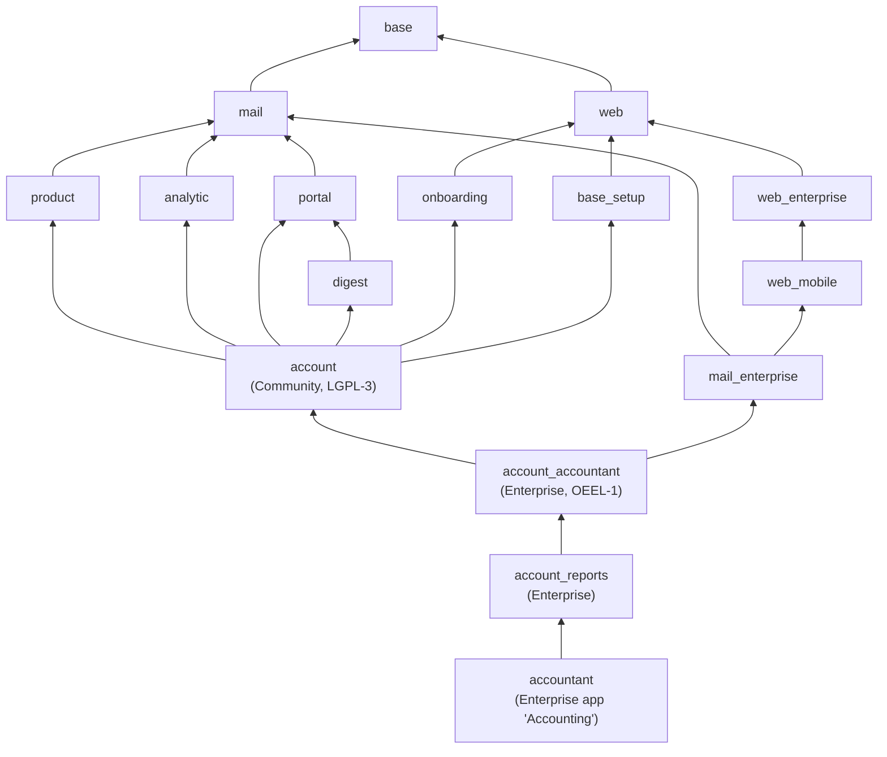

# Odoo accounting modules

The modules behind Odoo accounting in 19.0 and how they depend on each other, read from their
`__manifest__.py` files.

## Dependency tree

*Arrows point from a module to what it depends on; the smaller technical modules (`uom`, `bus`,
`html_editor`, `auth_signup`, `http_routing`, `resource`, `web_tour`) are left out.*

## What each one is

| Module | Edition | What it holds |
| --- | --- | --- |
| `account` | Community | The whole accounting engine: chart of accounts, journals, journal entries and items, taxes, invoices and bills, payments, bank statements, reconciliation, lock dates, analytic distribution on lines. Its menu is "Invoicing". |
| `account_accountant` | Enterprise | The accountant's tools: bank reconciliation screen, reconciliation models and wizards, fiscal years, the lock date wizard, deferred revenue and expense. |
| `account_reports` | Enterprise | Financial reports: balance sheet, profit and loss, general ledger, trial balance, partner ledgers, aged balances, tax report, cash flow, and their export. |
| `accountant` | Enterprise | The "Accounting" application itself: menus and access rights. Installing it installs the two above. |

Community alone posts and stores every entry the GL sync creates. Enterprise adds the screens and
reports an accountant uses to check and close the books (see [enterprise.md](enterprise.md)).

## Size, for orientation

Counting Python, XML, JS, SCSS and CSV, `account` is about 5.5 MB in 382 files; its whole dependency
chain is about 46 MB, most of it the web client (`web` alone is about 22 MB of mostly JavaScript).
The Python of the full chain, Enterprise included, is about 7 MB. The business logic that matters for
the GL sync is in a handful of `account/models/*.py` files, copied in [source/](source/README.md).
