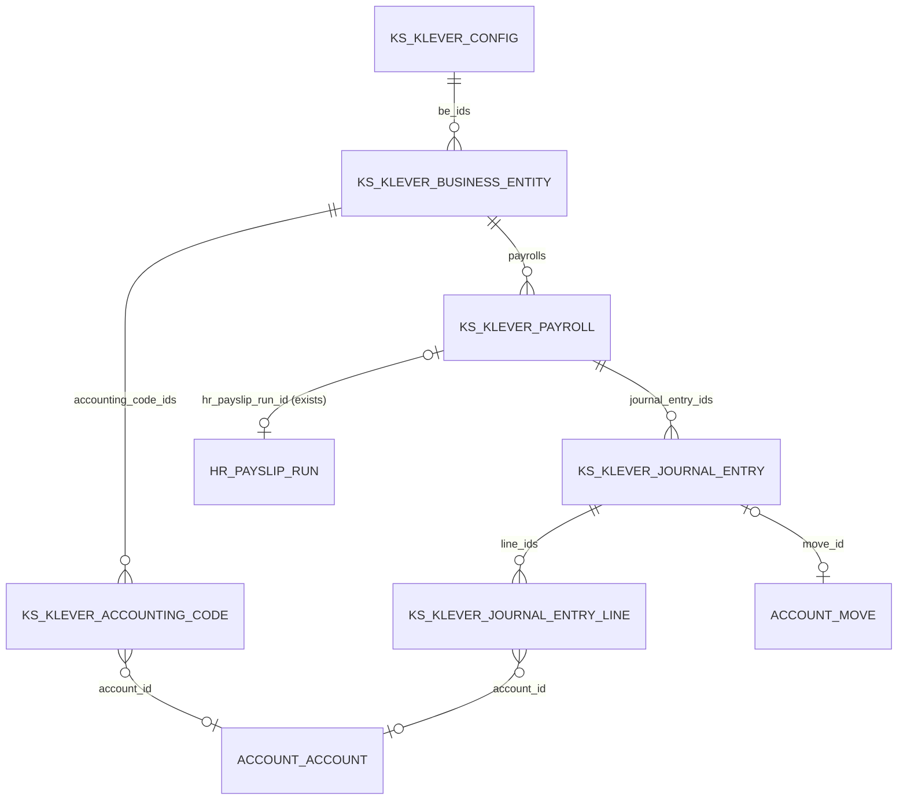
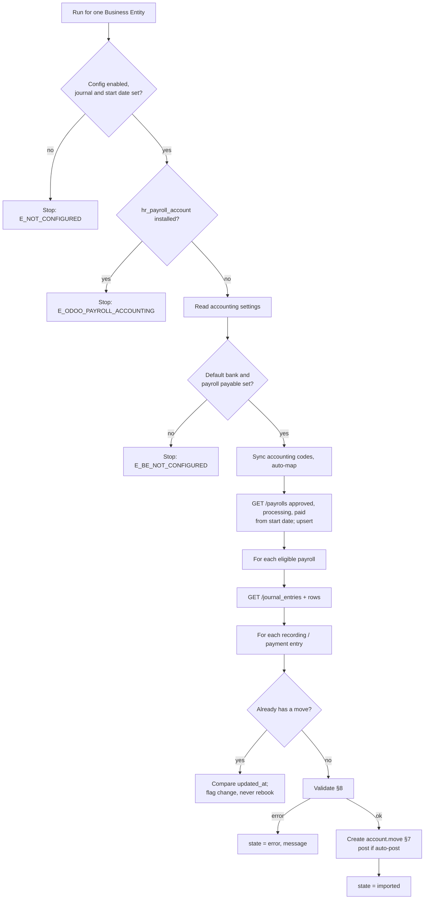
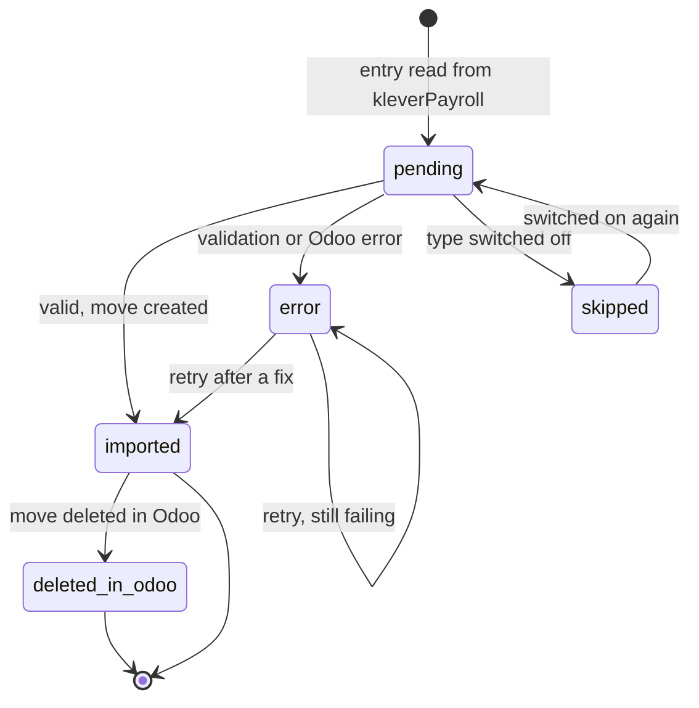

# GL journal entries sync — specification

Import the journal entries kleverPayroll generates for each approved payroll into Odoo Accounting
as `account.move` records, linked to the payroll, without duplicates, with every error visible to
the user.

| | |
| --- | --- |
| Status | **Draft** by Dan and his agent, 7 Nov 2026. Hatem (payroll) and Mariana (accounting) correct it, decide the open points and approve it as the implementation scheme; Dmytro signs off technically; Dan implements |
| Code repository | `klever_payroll_19` (Azure DevOps), folder `addons_kodershop/` |
| New module | `ks_klever_payroll_account` |
| Odoo | 19.0, Enterprise runtime (Community `account` is enough for this module) |
| Requirements | R1–R7 in [Accounting §1](../ACCOUNTING_kleverPayroll.md#1-the-task-as-received) |
| Decisions used | D1–D9 in [Accounting §3](../ACCOUNTING_kleverPayroll.md#3-decisions) — all still *Proposed* |
| API facts | [klever_api/](../klever_api/README.md) |
| Task | [Implement the GL journal entries sync](../tasks/2026-11-07-gl-sync-implementation.md) |

**How to read this spec.** It never decides anything itself. Wherever a decision is still open, the
spec names the **default** it is built with and links the question. Defaults are built as
configuration where that is cheap, so a different answer from Hatem or Mariana is a setting, not a
rewrite. Section numbers (§) are referenced from the task and the tests.

---

## 1. Scope

### 1.1 In scope (version 1)

1. Mirror the Business Entity's **accounting codes** from kleverPayroll and map each one to an Odoo
   `account.account` (automatic by code, editable by the user).
2. Read the **accounting settings** of the Business Entity and refuse to sync when they are
   incomplete (the "Accounting Information properly configured" condition).
3. For every eligible payroll, read its **journal entries** of type `payroll_recording` and
   `payroll_payment` with their rows.
4. Validate each entry; create one **`account.move`** per valid entry, in draft or posted.
5. Link every move to its `ks.klever.payroll` (and through it to the Odoo Pay Run).
6. Never import the same entry twice, from any number of runs, in parallel or not.
7. Keep a **sync record per entry** with its state and error, visible to users; summarise each
   scheduled run.
8. Trigger: an hourly **scheduled action** and **"Sync now"** buttons.

### 1.2 Out of scope (version 1)

| Item | Why | Decision |
| --- | --- | --- |
| `pay_stub_recording` entries | Would double-count the payroll | D1 |
| Draft and failed payrolls | Codes not fixed / payment failed | D2 |
| Analytic distribution, departments, projects | Row reference shows no tags; the vendor overview says rows carry them ([conflict](../klever_api/accounting-overview.md#conflict-tags-on-journal-entry-rows)). Store any tag data received in `raw_json`, book nothing from it | D8, Q10 |
| Segment templates | Report-only, never exported | D8 |
| EHT, WCB, vacation accrual | Not in the vendor's entries | D8 |
| Pushing the Odoo chart of accounts to kleverPayroll | Phase 2 | D9 |
| Reversing or updating an already imported entry | Corrections come as correction payrolls | D7 |
| Bank statement reconciliation itself | Standard Odoo; this spec only makes it possible (§7.4) | — |
| Multi-currency | Payroll is in CAD; a company in another currency is refused (§8, `E_CURRENCY`) | — |

---

## 2. Module

### 2.1 Why a separate module

`ks_klever_payroll_client` does not depend on `account`. A client company that runs payroll without Odoo
Accounting must keep being able to install it. The GL sync therefore goes into a bridge module, the
same split as Odoo's own `hr_payroll` → `hr_payroll_account` (D6).

### 2.2 Manifest

```python
{
    'name': 'kleverPayroll Accounting',
    'author': 'Kodershop.com',
    'website': 'https://kodershop.com/',
    'category': 'Human Resources/Payroll',
    'license': 'OPL-1',
    'version': '19.0.1.0',            # the dev suffix is added by /gap, e.g. 19.0.1.0.1001
    'summary': 'Import kleverPayroll journal entries into Odoo Accounting',
    'depends': ['ks_klever_payroll_client', 'account'],
    'data': [
        'security/ir.model.access.csv',
        'security/klever_account_security.xml',
        'data/ir_cron.xml',
        'views/klever_accounting_code.xml',
        'views/klever_journal_entry.xml',
        'views/klever_config.xml',
        'views/klever_business_entity.xml',
        'views/klever_payroll.xml',
        'views/account_move.xml',
        'views/_menu.xml',
    ],
    'installable': True,
    'application': False,
    'auto_install': False,
}
```

- **Must not** depend on `hr_payroll_account`. See §8 `E_ODOO_PAYROLL_ACCOUNTING`.
- `auto_install` stays `False`: installing Accounting on a payroll database must not start booking
  entries by itself.
- `CHANGELOG.md` beside the manifest, per the code repository's changelog rules.

### 2.3 File layout

```
ks_klever_payroll_account/
├── __init__.py
├── __manifest__.py
├── CHANGELOG.md
├── data/ir_cron.xml
├── models/
│   ├── __init__.py
│   ├── klever_config.py              # _inherit ks.klever.config: settings, API helper, sync entry points
│   ├── klever_business_entity.py     # _inherit: accounting settings snapshot, buttons
│   ├── klever_accounting_code.py     # new: ks.klever.accounting.code
│   ├── klever_journal_entry.py       # new: ks.klever.journal.entry (+ .line)
│   ├── klever_payroll.py             # _inherit ks.klever.payroll: links, GL state, buttons
│   └── account_move.py               # _inherit account.move: back-links, guards
├── security/
│   ├── ir.model.access.csv
│   └── klever_account_security.xml   # multi-company rules
├── tests/
│   ├── __init__.py
│   ├── common.py                     # fixtures + mocked API
│   └── test_gl_sync.py
└── views/ … (as listed in the manifest)
```

---

## 3. Data model



*New models on the right of the payroll; `ks.klever.config`, the Business Entity and the payroll
already exist in the client module.*

### 3.1 `ks.klever.accounting.code` (new)

Mirror of one kleverPayroll accounting code, plus its Odoo account.

| Field | Type | Required | Description |
| --- | --- | --- | --- |
| `business_entity_id` | Many2one `ks.klever.business.entity`, `ondelete='cascade'`, index | yes | |
| `company_id` | Many2one `res.company`, related `business_entity_id.company_id`, stored, index | — | For record rules |
| `ks_klever_ref_accounting_code_id` | Char, readonly, index, `copy=False` | yes | Vendor id |
| `title` | Char, readonly | yes | |
| `code` | Char, readonly, index | no | Vendor `code`; the key journal entry rows refer to |
| `code_type` | Selection `expense`/`liability`/`bank`, readonly | yes | Vendor `type` |
| `description` | Text, readonly | no | |
| `account_id` | Many2one `account.account`, `check_company=True` | no | The mapping. Editable by accountants |
| `is_auto_mapped` | Boolean, readonly | — | True when `account_id` was set by the code match (§5.2); a manual change sets it False |
| `mapping_warning` | Char, computed (not stored) | — | §5.4 |
| `active` | Boolean, default True | — | False when the code disappeared from kleverPayroll |
| `klever_updated_at` | Datetime, readonly | — | |

Constraint: `models.Constraint('UNIQUE(business_entity_id, ks_klever_ref_accounting_code_id)', 'This accounting code is already synced.')`.

`_rec_name`: computed `display_name` = `"<code> <title>"`, or just the title when there is no code.

### 3.2 `ks.klever.journal.entry` (new)

One row per kleverPayroll journal entry of an imported type. It is both the mirror of the entry and
its **sync record** (R7). `_order = 'pay_date desc, id desc'`. Inherits `mail.thread` so errors and
state changes are in its chatter.

| Field | Type | Required | Description |
| --- | --- | --- | --- |
| `payroll_id` | Many2one `ks.klever.payroll`, `ondelete='restrict'`, index | yes | R5 |
| `business_entity_id` | related `payroll_id.business_entity_id`, stored, index | — | |
| `company_id` | related `business_entity_id.company_id`, stored, index | — | |
| `hr_payslip_run_id` | related `payroll_id.hr_payslip_run_id` | — | Shown on the form (R5 "Pay Run") |
| `pay_date` | related `payroll_id.pay_date`, stored | — | Sorting and filtering |
| `ks_klever_ref_journal_entry_id` | Char, readonly, index, `copy=False` | yes | **The duplicate key** (R6) |
| `entry_type` | Selection `payroll_recording`/`payroll_payment`, readonly | yes | |
| `title` | Char, readonly | no | Vendor `title` (English) |
| `is_balanced` | Boolean, readonly | — | Vendor flag, as received |
| `is_missing_line_item_accounting_codes` | Boolean, readonly | — | Truthy value → True |
| `is_missing_default_account_payable` | Boolean, readonly | — | |
| `is_missing_default_bank_account` | Boolean, readonly | — | |
| `invalid_types_text` | Text, readonly | — | §8 `E_INVALID_TYPES`, human-readable |
| `posted_on` | Date, readonly | — | Vendor `posted_on` (export date to Xero/QuickBooks), information only (§7.3) |
| `klever_updated_at` | Datetime, readonly | — | Vendor `updated_at` |
| `raw_json` | Text, readonly, `groups='base.group_no_one'` | — | Last response for this entry, for support |
| `line_ids` | One2many `ks.klever.journal.entry.line` | — | Rows |
| `total_debit`, `total_credit` | Monetary, computed from `line_ids`, stored | — | Our own sums, never vendor `total` |
| `currency_id` | related `company_id.currency_id` | — | |
| `state` | Selection, see §9, default `pending`, tracking | yes | |
| `error_code` | Char, readonly | — | §8 code, e.g. `E_UNMAPPED_CODE` |
| `error_message` | Text, readonly | — | §8 text |
| `move_id` | Many2one `account.move`, readonly, `copy=False`, index | — | R4, R5 |
| `move_state` | related `move_id.state` | — | |
| `is_changed_after_import` | Boolean, readonly | — | §6.6 |
| `last_sync_at` | Datetime, readonly | — | |

Constraint: `models.Constraint('UNIQUE(ks_klever_ref_journal_entry_id)', 'This kleverPayroll journal entry is already synced.')`.

`unlink()`: forbidden while `move_id` is set (`UserError`, §8 `E_DELETE_IMPORTED`).

### 3.3 `ks.klever.journal.entry.line` (new)

| Field | Type | Description |
| --- | --- | --- |
| `entry_id` | Many2one `ks.klever.journal.entry`, `ondelete='cascade'`, required, index | |
| `sequence` | Integer | Order received from the API |
| `ks_klever_ref_row_id` | Char | Vendor row `id` |
| `row_type` | Selection `debit`/`credit` | Vendor `type` |
| `amount` | Monetary (`currency_id` related to the entry) | Vendor `amount`, as received (§7.2) |
| `code` | Char | Vendor `code` |
| `description` | Char | Vendor `description` |
| `accounting_code_id` | Many2one `ks.klever.accounting.code` | Resolved at sync (§5.3) |
| `account_id` | Many2one `account.account` | Resolved at sync (§5.3); empty = unmapped |

The rows are replaced on every sync of a **not yet imported** entry (`Command.clear()` +
`Command.create()`), and never touched again once `move_id` is set.

### 3.4 `ks.klever.payroll` (inherit)

| Field | Type | Description |
| --- | --- | --- |
| `journal_entry_ids` | One2many `ks.klever.journal.entry` | |
| `move_ids` | Many2many `account.move`, computed from `journal_entry_ids.move_id` | Smart button |
| `gl_state` | Selection, computed, stored, depends on `journal_entry_ids.state` | `not_synced` (no entries), `error` (any entry in error), `partial` (some imported, others pending), `done` (every entry imported or skipped) |

Buttons on the form: **Sync Journal Entries** (`action_sync_klever_journal_entries`, §6), smart
button **Journal Entries (n)** opening `move_ids`.

### 3.5 `account.move` (inherit)

| Field | Type | Description |
| --- | --- | --- |
| `ks_klever_journal_entry_id` | Many2one `ks.klever.journal.entry`, readonly, `copy=False`, index | |
| `ks_klever_payroll_id` | Many2one `ks.klever.payroll`, readonly, `copy=False`, index | R5 |

Constraint: `models.Constraint('UNIQUE(ks_klever_journal_entry_id)', 'This kleverPayroll journal entry is already in the books.')`.
PostgreSQL `UNIQUE` lets many rows be NULL, so ordinary moves are not affected. This is the second
line of defence against duplicates after §6.5.

Behaviour:

- `copy()` of an imported move: the two fields are not copied (`copy=False`), so a copy is an
  ordinary manual move.
- `unlink()` of an imported move (allowed by Odoo only in draft): allowed. The sync record keeps its
  `move_id` cleared by `ondelete='set null'`, and moves to state `deleted_in_odoo` (§9). It is **not
  re-imported** (D7, Q15).
- Form view: a banner on imported moves — "Imported from kleverPayroll, <payroll name>. Correct
  payroll amounts in kleverPayroll with a correction payroll; it is imported as a new entry."

### 3.6 `ks.klever.config` (inherit) — settings, one record per company

| Field | Type | Default | Description | Question |
| --- | --- | --- | --- | --- |
| `gl_sync_enabled` | Boolean | False | Master switch; the scheduled action skips companies where it is off | Q2 |
| `gl_journal_id` | Many2one `account.journal`, domain `[('type', '=', 'general'), ('company_id', '=', company_id)]` | — | Journal for every imported move. Required when enabled | Q9 |
| `gl_sync_from_date` | Date | — | Payrolls with `pay_date` before it are never imported. Required when enabled | Q3 |
| `gl_auto_post` | Boolean | False | Post moves on creation | Q1 |
| `gl_import_payment_entry` | Boolean | True | Import `payroll_payment` too | Q6 |
| `gl_include_historical` | Boolean | False | Import `historical` payrolls | Q4 |
| `gl_responsible_id` | Many2one `res.users` | — | Gets an activity for each entry that fails (§10.3) | Q13 |
| `gl_last_sync_at` | Datetime, readonly | — | End of the last completed run | |

`@api.constrains`: when `gl_sync_enabled`, `gl_journal_id` and `gl_sync_from_date` must be set, and
the journal's company must be the config's company.

The settings sit on a new **Accounting** page of the `ks.klever.config` form (accountants only).

### 3.7 `ks.klever.business.entity` (inherit)

| Field | Type | Description |
| --- | --- | --- |
| `accounting_code_ids` | One2many `ks.klever.accounting.code` | |
| `acc_default_bank_code` | Char, readonly | From `accounting_settings.default_bank_accounting_code` (its `code`, or title if no code) |
| `acc_default_payroll_payable_code` | Char, readonly | From `accounting_settings.default_payroll_payable_accounting_code` |
| `acc_block_approval_on_incomplete` | Boolean, readonly | From `accounting_settings.block_approval_on_incomplete_journal_entries` |
| `acc_settings_synced_at` | Datetime, readonly | |
| `acc_is_configured` | Boolean, computed | Both default codes are set (§6.2) |

Buttons on the BE form, Accounting page: **Sync Accounting Codes**, **Auto-map by Code**, **Sync
Journal Entries**.

---

## 4. API access

Add one helper on `ks.klever.config` in the new module and use it for every call of this spec:

```python
def _klever_api_get(self, path, params=None):
    """GET <base_url><path> with the company token; return the decoded JSON.

    Raises KleverApiError (a UserError subclass defined in this module) carrying the HTTP status,
    so the sync can turn it into an E_API_* state instead of aborting the whole run.
    """
```

- Base URL: `self._get_klever_api_base_url()` (exists).
- Token: `self._ensure_klever_token()`, then `self.sudo().ks_klever_access_token` (exists) — the same
  pattern as `ks.klever.payroll._fetch_klever_payroll()`.
- Headers: `Authorization: Bearer …`, `Accept: application/json`. Timeout: the module's
  `KLEVER_REQUEST_TIMEOUT` (30 s).
- Error text: `klever_http_error_message()` from `models/klever_decorators.py` (exists).
- A `401` triggers one token refresh and one retry; a second `401` is `E_API_AUTH`.
- `429` and `5xx`: no retry inside the run; the entry or payroll keeps its state and the next run
  tries again (`E_API_UNAVAILABLE`).
- Pagination helper `_klever_api_get_all(path, params)`: loop on `page` until
  `meta.has_more` is false; hard stop after 200 pages with `E_API_PAGINATION` (protects against a
  loop if the vendor ever ignores `page`).
- Never log the token or the full `Authorization` header. Log the path, the params and the status.

Calls used:

| Purpose | Call |
| --- | --- |
| Accounting settings | `GET /business_entities/{be_id}` → `data.accounting_settings` **(endpoint to confirm, sandbox check 1)** |
| Accounting codes | `GET /accounting_codes?business_entity_id={be_id}` (all pages) |
| Payrolls | `GET /payrolls?business_entity_id={be_id}&status=approved,processing,paid&pay_date[gte]={sync_from}&sort=pay_date` (all pages) |
| Journal entry ids of a payroll | `GET /journal_entries?payroll_id={payroll_id}` (all pages) |
| One journal entry with rows (vendor-recommended) | `GET /journal_entries/{id}?expand=journal_entry_rows` |

Every object comes in the API envelope `{id, object, data: {...}, links}`: read the vendor id from
`id` and every other field from `data` — the same as `_upsert_from_klever()` does for payrolls.

Payrolls are upserted through the **existing** `ks.klever.payroll._upsert_from_klever()`; do not
write a second payroll parser.

---

## 5. Account mapping (R2, R3)

### 5.1 Sync of accounting codes

`ks.klever.business.entity.action_sync_klever_accounting_codes()`:

1. Fetch all pages of accounting codes of the BE.
2. Upsert by `ks_klever_ref_accounting_code_id`: write `title`, `code`, `code_type`, `description`,
   `klever_updated_at`, `active=True`. **Never overwrite `account_id`** here.
3. Codes of this BE that were not in the response: `active=False` (archived, not deleted — old
   journal entry lines may refer to them).
4. Then run §5.2 for the codes without `account_id`.
5. Return a notification: "N accounting codes synced, M mapped automatically, K still unmapped."

It also runs at the start of every journal entry sync of the BE (§6.1 step 2), so a new code in
kleverPayroll never waits for a manual click.

### 5.2 Automatic mapping by code

For each active accounting code with a non-empty `code` and an empty `account_id`:

```python
accounts = self.env['account.account'].with_company(company).search([
    ('code', '=', code.strip()),
    ('company_ids', 'parent_of', company.id),
    ('active', '=', True),
], limit=2)
```

- Exactly one match → set `account_id`, `is_auto_mapped=True`.
- None or two → leave empty; the code shows as unmapped.
- Compare codes as stripped strings. No other normalisation (no removing leading zeros, no
  case-folding): accounting codes are identifiers, and a fuzzy match would silently book to the
  wrong account.

"Auto-map by Code" on the BE runs only this step.

### 5.3 Resolving a journal entry row to an account

For row `code` *c* of an entry of BE *be*:

1. *c* empty or missing → unresolved (`E_EMPTY_CODE`). Default until sandbox check Q20 says
   otherwise.
2. Look up the active `ks.klever.accounting.code` of *be* whose `code` = *c*.
   - Found with `account_id` → use it.
   - Found without `account_id` → unresolved (`E_UNMAPPED_CODE`).
   - Several found (the vendor allows duplicates until merged) → use the one with `account_id` if
     exactly one has it; otherwise `E_AMBIGUOUS_CODE`.
3. Not found → run §5.1 once for the BE (the code may be new), then retry step 2 once.
   Still not found → `E_UNKNOWN_CODE`.

The resolved accounting code and account are written on the `ks.klever.journal.entry.line`, so the
user sees exactly which row failed and why.

### 5.4 Mapping warnings (shown, never blocking)

`mapping_warning` on `ks.klever.accounting.code`:

| Condition | Warning |
| --- | --- |
| `code_type == 'expense'` and the account's `internal_group` is not `expense` | "An expense code is mapped to a non-expense account." |
| `code_type == 'liability'` and the account's `internal_group` is not `liability` | "A liability code is mapped to a non-liability account." |
| `code_type == 'bank'` and `account_type == 'asset_cash'` | "Bank statements imported into this journal will book the payroll debit a second time. Map the payroll bank code to the bank journal's Outstanding Payments account or to a payroll clearing account instead." (§7.4) |
| `account_id.company_ids` does not include the BE's company | "The account does not belong to this company." (also prevented by `check_company`) |

The list view of accounting codes shows unmapped codes first, in red (`decoration-danger`), and
warnings in orange (`decoration-warning`).

---

## 6. Sync algorithm (R1, R5, R6, R7)



*One run per Business Entity; each entry is validated and booked on its own, so one bad entry never
blocks the others.*

### 6.1 Entry points

| Entry point | Scope | Who |
| --- | --- | --- |
| `ks.klever.config._cron_sync_gl_journal_entries()` | Every config with `gl_sync_enabled`, every registered BE of it | Scheduled action, hourly (§10.1) |
| `ks.klever.config.action_sync_gl_journal_entries()` | All BEs of this config | "Sync now" on the config, Accounting page |
| `ks.klever.business.entity.action_sync_klever_journal_entries()` | One BE | Button on the BE |
| `ks.klever.payroll.action_sync_klever_journal_entries()` | One payroll (steps 4–6 only, after steps 1–3 for its BE) | Button on the payroll |
| `ks.klever.journal.entry.action_retry()` | Selected entries in `error`/`pending` (re-fetch their payroll's entries, then steps 5–6) | List action, after the user fixed a mapping |

All of them end in the same private method per BE, `_sync_gl_for_business_entity(payrolls=None)`, so
the rules below hold whatever started the run.

### 6.2 Steps for one Business Entity

1. **Preconditions** (any failure stops this BE, nothing is booked; the error goes to the run summary
   §10.2 and, for a button, to a `UserError`):
   - BE has `ks_klever_ref_business_entity_id` → else `E_BE_NOT_REGISTERED`.
   - BE has `company_id`; config `gl_sync_enabled`, `gl_journal_id`, `gl_sync_from_date` set → else
     `E_NOT_CONFIGURED`.
   - Company currency is CAD → else `E_CURRENCY`.
   - Module `hr_payroll_account` is not installed
     (`self.env['ir.module.module'].sudo().search_count([('name', '=', 'hr_payroll_account'), ('state', '=', 'installed')])`)
     → else `E_ODOO_PAYROLL_ACCOUNTING`.
2. **Accounting settings.** Read them (§4) into the `acc_*` fields of the BE. Both
   `default_bank_accounting_code` and `default_payroll_payable_accounting_code` empty or missing →
   `E_BE_NOT_CONFIGURED`, stop. This is the task's condition "GL data can be extracted only if
   Accounting Information is properly configured" (R2).
3. **Accounting codes.** §5.1 (including §5.2).
4. **Payrolls.** Fetch with the filter in §4, upsert through `_upsert_from_klever()`. Then select the
   **eligible** payrolls locally from `ks.klever.payroll` of this BE:
   - `status in ('approved', 'processing', 'paid')` (D2);
   - `pay_date >= gl_sync_from_date` (Q3);
   - `type != 'historical'` unless `gl_include_historical` (Q4);
   - `gl_state != 'done'` — a payroll whose entries are all imported or skipped is not fetched again.
     Exception: payrolls with `gl_state == 'done'` and `pay_date` in the last 35 days are still
     re-read, so §6.6 can notice a late change.
   - Order: `pay_date`, then `id`.
5. **Journal entries of one payroll.** Fetch all pages of `/journal_entries?payroll_id=…` to get the
   entry ids and types. For every entry of type `payroll_recording` / `payroll_payment` that is not
   yet imported, retrieve it with `GET /journal_entries/{id}?expand=journal_entry_rows` (the call the
   vendor recommended) and use that response. Already imported entries are compared on the list
   item's `updated_at` only (§6.6), without a retrieve. For each entry:
   - `type == 'pay_stub_recording'` → ignore, store nothing (D1).
   - `type == 'payroll_payment'` and not `gl_import_payment_entry` → upsert with state `skipped`,
     `error_code = 'S_PAYMENT_DISABLED'`.
   - Any other type not in the known list → ignore and log a warning (a new vendor type must not be
     booked blindly).
   - Upsert `ks.klever.journal.entry` by `ks_klever_ref_journal_entry_id`:
     - not imported yet (`move_id` empty and state not in `imported`, `deleted_in_odoo`): write all
       mirror fields and replace `line_ids` (§3.3);
     - already imported: write only `klever_updated_at`, `last_sync_at` and §6.6.
6. **Book each not-yet-imported entry** of the payroll, one at a time, each inside its own savepoint
   (`with self.env.cr.savepoint():`):
   1. Lock it (§6.5). Lock not obtained → skip silently, another run is on it.
   2. Re-read `move_id` after the lock; set → skip (another run booked it a moment ago).
   3. Validate (§8). First failing rule → `state='error'`, `error_code`, `error_message`; next entry.
   4. Create the move (§7). Any exception from Odoo (lock date, inactive account, constraint) is
      caught by the savepoint → `state='error'` with `E_ODOO_REJECTED` and the exception text.
   5. Success → `state='imported'`, `move_id`, `error_code=False`, `error_message=False`; post a
      chatter message on the `ks.klever.payroll` with a link to the move.
7. After the BE: update `gl_state` of its payrolls (stored compute does this) and write the run
   summary (§10.2).

### 6.3 What a re-run does

| Entry state before | Re-run does |
| --- | --- |
| no record | creates it, validates, books |
| `pending` | validates, books |
| `error` | refreshes from the API, validates again, books if now valid (e.g. after the user mapped a code) |
| `skipped` | nothing, unless the reason went away (payment import switched on) — then back to `pending` |
| `imported` | never books again; only §6.6 |
| `deleted_in_odoo` | never books again (D7) |

### 6.4 Transactions

- **Scheduled action:** after each payroll, call `self.env['ir.cron']._commit_progress(1)` so a crash
  later in the run keeps what is already booked, and the cron UI shows progress. Before the loop,
  `_commit_progress(remaining=<number of eligible payrolls>)`.
- **Buttons:** one transaction for the whole click; per-entry savepoints keep one bad entry from
  rolling back the others. If the click fails outright (precondition), nothing is written.
- Never call `cr.commit()` directly.

### 6.5 Duplicate protection (R6)

Three independent layers; each alone prevents a double booking:

1. **Upsert by vendor id** on `ks.klever.journal.entry` with a `UNIQUE` constraint — at most one sync
   record per vendor entry.
2. **Row lock** before booking:
   ```python
   self.env.cr.execute(
       'SELECT id FROM ks_klever_journal_entry WHERE id = %s FOR UPDATE NOWAIT', [entry.id],
   )
   ```
   catching `psycopg2.errors.LockNotAvailable` inside the savepoint. Raw SQL is used only here,
   because the ORM has no row-lock API. Then re-check `move_id` (§6.2 step 6.2).
3. **`UNIQUE(ks_klever_journal_entry_id)` on `account.move`** — even a bug in layers 1–2 cannot
   create a second move for the same entry; the savepoint turns it into `E_ODOO_REJECTED`.

`external_ref` on the payroll and `integrations.*.reference` on the entry are **not** used for
de-duplication: the first is free text, the second has no Odoo slot.

### 6.6 An entry changed after import

kleverPayroll keeps the codes resolved at approval, so an approved payroll's entries should not
change. If they do:

- `klever_updated_at` received is later than the stored one, on an entry with `move_id` → set
  `is_changed_after_import=True`, post a chatter note on the sync record and on the move: "kleverPayroll
  changed this journal entry on <date>, after it was imported. The Odoo entry was not changed. Compare
  the two and correct by hand if needed."
- Never modify, reverse or recreate the move (D7).
- The flag shows as a filter "Changed after import" in the sync list.

The same applies to a payroll that becomes `failed` after its entries were imported (Q16): set the
flag on its imported entries with the text "This payroll failed in kleverPayroll after its entries
were imported."

---

## 7. Building the `account.move` (R4)

### 7.1 Header

| Field | Value |
| --- | --- |
| `move_type` | `'entry'` |
| `journal_id` | `config.gl_journal_id` |
| `company_id` | the BE's company |
| `date` | §7.3 |
| `ref` | `"kleverPayroll · <payroll display_name> · <entry title or type label>"`, e.g. `kleverPayroll · Period 22 - 2026-10-18 to 2026-10-31, Canadian Employee bi-weekly Hourly · Payroll recording` |
| `narration` | `"kleverPayroll journal entry <vendor id>, payroll <vendor payroll id>."` |
| `ks_klever_journal_entry_id`, `ks_klever_payroll_id` | the sync record and its payroll |
| `line_ids` | §7.2, with `Command.create()` |

Create with `self.env['account.move'].with_company(company).create(vals)`; when `gl_auto_post`, call
`move.action_post()` in the same savepoint. A posting error leaves **no** draft behind (the savepoint
rolls back the creation too) and goes to `E_ODOO_REJECTED`.

### 7.2 Lines

One `account.move.line` per vendor row, in the vendor's order. **Rows are not grouped or merged**, so
the Odoo entry reads line by line like the vendor's.

| Line field | Value |
| --- | --- |
| `account_id` | §5.3 |
| `name` | row `description`; empty → the accounting code title; still empty → the code |
| `debit` | `amount` if `row_type == 'debit'`, else `0.0` |
| `credit` | `amount` if `row_type == 'credit'`, else `0.0` |
| `partner_id` | none — rows carry no partner |
| `analytic_distribution` | none (D8) |

Amount rules (financial precision — none of these may be relaxed without a decision):

- Amounts are taken **as received**, as decimal dollars. If sandbox check Q19 shows they are in
  cents, the conversion is one place: `_klever_amount(value)` in `klever_journal_entry.py`.
- Round each amount with `company.currency_id.round()`. Do not round sums.
- A negative amount → `E_NEGATIVE_AMOUNT`. Never flip a negative debit into a credit silently (Q19).
- A zero amount → the row is kept in the sync record but **no move line** is created for it.
- After building the lines: `currency.compare_amounts(sum(debit), sum(credit)) != 0` → `E_UNBALANCED`.
  Never add a balancing, rounding or suspense line (D4).

### 7.3 Accounting date (Q18)

1. `payroll_recording` → payroll `pay_date`.
2. `payroll_payment` → payroll `debit_date`, falling back to `pay_date`.
3. Still empty → `E_NO_DATE`.

The vendor's `posted_on` is **not** used: its reference describes it as the date the entry was posted
to the accounting system (the Xero/QuickBooks export). It is stored on the sync record for
information only; parse both the date and the datetime shape (`2026-01-30T00:00:00.000000Z`).

Lock dates: do **not** move the date forward to get past a lock date. Odoo's own check refuses the
move; the error becomes `E_ODOO_REJECTED` with Odoo's message, and the accountant decides.

### 7.4 The bank side and reconciliation

The `payroll_payment` entry credits the account mapped to the vendor's default bank code. If that is
the bank journal's own `asset_cash` account and the bank statement is also imported, the debit is
booked twice: once by this entry, once by the statement line. The recommended mapping is the bank
journal's **Outstanding Payments** account (or a reconcilable "Payroll clearing" account): the
statement line of `cash_requirement` on `debit_date` is then reconciled against our payment entry in
Odoo's standard bank reconciliation. The module warns (§5.4) but does not block, because the
client company may not import statements (Q6).

---

## 8. Validation rules and messages (R7)

Checked in this order; the first failure wins. Messages are plain English (no `_()`), name the
payroll, and say what to do.

| Code | Rule | Message |
| --- | --- | --- |
| `E_BE_NOT_REGISTERED` | BE has no kleverPayroll id | "Business Entity <name> is not registered with kleverPayroll yet." |
| `E_NOT_CONFIGURED` | Sync disabled, or journal / start date missing | "Set the Payroll journal and the start date on the Accounting page of the kleverPayroll configuration, and switch the sync on." |
| `E_CURRENCY` | Company currency is not CAD | "kleverPayroll pays in CAD, but company <name> keeps its books in <currency>. Journal entries are not imported." |
| `E_ODOO_PAYROLL_ACCOUNTING` | `hr_payroll_account` installed | "Odoo Payroll Accounting is installed and would book every payroll a second time from the payslips. Uninstall it before importing kleverPayroll journal entries." |
| `E_BE_NOT_CONFIGURED` | Default bank or payroll payable code missing | "Accounting Information is not complete in kleverPayroll for <BE>: set the default bank and payroll payable accounting codes (kleverPayroll → Accounting Details → Settings)." |
| `E_VENDOR_UNBALANCED` | `is_balanced` false | "kleverPayroll reports this journal entry as unbalanced. Fix the payroll's accounting in kleverPayroll." |
| `E_VENDOR_MISSING_CODES` | any `is_missing_*` truthy | "kleverPayroll reports missing accounting codes: <which flags, in words>." |
| `E_INVALID_TYPES` | `invalid_expense_types` or `invalid_liability_types` not empty | "These line items have no accounting code in kleverPayroll: Expense — <type/subtype, …>; Liability — <…>. Add accounting code rules for them." |
| `E_NO_ROWS` | entry has no rows | "kleverPayroll returned this journal entry without rows." |
| `E_EMPTY_CODE` | a row has an empty `code` | "Row <n> (<description>, <amount>) has no accounting code number in kleverPayroll." |
| `E_UNKNOWN_CODE` | row code not among the BE's accounting codes | "Accounting code <code> is not known for <BE>. Sync accounting codes and retry." |
| `E_AMBIGUOUS_CODE` | several accounting codes with that code, none or several mapped | "Accounting code <code> exists <n> times in kleverPayroll. Merge the duplicates there, or map exactly one of them." |
| `E_UNMAPPED_CODE` | accounting code has no Odoo account | "Accounting code <code> <title> is not mapped to an Odoo account. Map it under kleverPayroll → Accounting → Accounting Codes and retry." |
| `E_NEGATIVE_AMOUNT` | a row amount < 0 | "Row <n> has a negative amount (<amount>). Negative amounts are not imported until their treatment is agreed." |
| `E_UNBALANCED` | our own sums differ | "Debits <x> and credits <y> differ by <z> after rounding. Nothing was booked." |
| `E_NO_DATE` | §7.3 found no date | "No accounting date: the payroll has no pay date or debit date." |
| `E_ODOO_REJECTED` | Odoo raised while creating or posting | "Odoo refused the journal entry: <exception text>." |
| `E_API_AUTH` | 401 twice | "kleverPayroll refused the access token. Refresh the token on the configuration." |
| `E_API_UNAVAILABLE` | timeout, connection error, 429, 5xx | "kleverPayroll did not answer (<status or error>). The next run retries." |
| `E_API_PAGINATION` | > 200 pages | "kleverPayroll returned more than 200 pages; the sync stopped to avoid a loop." |
| `E_DELETE_IMPORTED` | `unlink()` of an imported sync record | "This journal entry is in the books; delete the Odoo entry first." |
| `S_PAYMENT_DISABLED` | (skip, not an error) | "Payment entries are not imported for this company." |

`E_BE_*`, `E_NOT_CONFIGURED`, `E_CURRENCY`, `E_ODOO_PAYROLL_ACCOUNTING`, `E_API_*` stop the BE; all
others are per entry.

---

## 9. States of a sync record



*`imported` and `deleted_in_odoo` are final: the sync never books that vendor entry again.*

| State | Label | Badge colour |
| --- | --- | --- |
| `pending` | Pending | info |
| `imported` | Imported | success |
| `error` | Error | danger |
| `skipped` | Skipped | muted |
| `deleted_in_odoo` | Deleted in Odoo | warning |

---

## 10. Trigger, logging and notifications

### 10.1 Scheduled action

`data/ir_cron.xml`, `noupdate="1"`:

```xml
<record id="ir_cron_klever_gl_sync" model="ir.cron">
    <field name="name">kleverPayroll: Import Journal Entries</field>
    <field name="model_id" ref="ks_klever_payroll_client.model_ks_klever_config"/>
    <field name="state">code</field>
    <field name="code">model._cron_sync_gl_journal_entries()</field>
    <field name="interval_number">1</field>
    <field name="interval_type">hours</field>
    <field name="active" eval="True"/>
</record>
```

Valid `ir.cron` fields only — no `numbercall`. It is active but does nothing for a company until
`gl_sync_enabled` is switched on (Q2). It runs as the cron user: every read and write in the sync that
needs it uses `sudo()` deliberately and filters by the config's company explicitly.

### 10.2 Run summary

Each run per BE that **changed something or failed** writes one `ks.event.log` row (model of
`ks_klever_payroll_employee`, already used by scheduled actions): add
`event_type` `('gl_sync', 'Journal Entries Imported')` with `selection_add`, and use
`_ks_log('gl_sync', name, company)`, where `name` is e.g. "BE One: 2 imported, 1 error, 0 skipped."
or the stopping error. A run that found nothing new writes nothing.

`gl_last_sync_at` on the config is set at the end of every completed run.

### 10.3 Notifications (Q13)

- Each entry that goes **into** `error` (not one already in error): a chatter message on the
  `ks.klever.payroll` with the error text, and, when `gl_responsible_id` is set, a single To-Do
  activity on the sync record ("Fix kleverPayroll journal entry import"). An entry already in error
  does not get a new activity on every hourly run.
- The activity is marked done automatically when the entry reaches `imported`.

### 10.4 Server log

`_logger.info` per BE with counts; `_logger.warning` per error with code, vendor entry id and payroll
id. No amounts, no employee data, no tokens in the log.

---

## 11. Views and menus

Menu, under the existing kleverPayroll menu of Payroll (find the parent in the client's
`views/_menu.xml`):

```
Payroll → kleverPayroll → Accounting
    ├── Journal Entry Imports     (ks.klever.journal.entry, list default filter "Errors" + "Pending")
    ├── Accounting Codes          (ks.klever.accounting.code, editable list)
    └── Sync Now                  (server action → action_sync_gl_journal_entries for the current company's config)
```

Visible to accountants (§12). Use `invisible="…"` expressions, never `attrs`.

**Journal Entry Imports — list:** pay date, payroll, entry type, total debit, state (badge), error
(truncated), Odoo entry (link), changed-after-import (icon). Filters: Errors, Pending, Imported,
Changed after import, this month; group by payroll, state, entry type. List action: **Retry**.

**Journal Entry Imports — form:** header with state and **Retry** / **Open Journal Entry** buttons;
an alert box with `error_message` when in error; payroll and Pay Run links; flags; rows sub-list
(code, description, debit, credit, accounting code, Odoo account — unresolved rows red); chatter.

**Accounting Codes — list (editable bottom):** code, title, type, Odoo account (editable), auto
mapped, warning, BE. Filters: Unmapped, With warning, Archived. Header buttons: **Sync Accounting
Codes**, **Auto-map by Code**.

**`ks.klever.config` form:** new page **Accounting** with the §3.6 settings, `gl_last_sync_at`, and
the **Sync Now** button.

**BE form:** page **Accounting** with the `acc_*` fields, a red alert when `acc_is_configured` is
false, the accounting code count (smart button) and the three buttons of §3.7.

**`ks.klever.payroll` form and list:** `gl_state` badge column; smart button **Journal Entries**; button
**Sync Journal Entries** visible when the status is eligible.

**`account.move` form:** the banner of §3.5 and the two links, in a group visible only when
`ks_klever_journal_entry_id` is set.

---

## 12. Security

| Model | `account.group_account_readonly` | `account.group_account_user` (Accountant) | `account.group_account_manager` | `hr_payroll.group_hr_payroll_user` |
| --- | --- | --- | --- | --- |
| `ks.klever.journal.entry` | read | read, write | read, write, create, unlink | read |
| `ks.klever.journal.entry.line` | read | read | read, write, create, unlink | read |
| `ks.klever.accounting.code` | read | read, write (mapping) | read, write, create, unlink | read |

- Check the group xml ids against Odoo 19 (`account/security/account_security.xml`) before writing the
  CSV.
- Creating and deleting sync records happens through the sync with `sudo()`; users never create them
  by hand.
- Multi-company `ir.rule` on all three models: `[('company_id', 'in', company_ids)]` (lines through
  `entry_id.company_id`).
- The **Accounting** page on the config and the sync buttons: `groups="account.group_account_manager"`.
  Payroll users see the `gl_state` badge and the smart button only.
- Buttons are public methods: each checks `self.env.user.has_group(...)` is not enough on its own —
  rely on the access rights of the records it touches, and do not `sudo()` before the check of the
  record's company.

---

## 13. Rules of the code repository

- **No vendor name** (`nmbr`) in any identifier, string, comment, log, XML id or file name. Only the
  API domains in the existing `_get_klever_api_base_url()`.
- User-visible text says **kleverPayroll**.
- No `from odoo import _` and no `_()`.
- `Command.create()` / `Command.clear()` for x2many; never `(0, 0, {...})`.
- `models.Constraint(...)` for SQL constraints (Odoo 19 style, as in `ks.klever.payroll`).
- No `attrs`; direct `invisible=` / `readonly=` / `required=` expressions.
- Short docstrings on public methods, cron methods and non-obvious helpers.
- No `search()` inside the row loop: load the BE's accounting codes once per BE into a dict
  `{code: [records]}` and resolve rows from it.
- The client module is not changed, except if a hook is truly needed; then say so in the task result.

---

## 14. Automated tests

`tests/test_gl_sync.py`, `@tagged('post_install', '-at_install')`, with the API mocked by patching
`requests.get` in the new module (no network). `tests/common.py` builds: a company in CAD, a
`ks.klever.config` with a token that does not expire, a registered BE, a general journal, accounts
`5000` Wages (expense), `5100` Employer CPP (expense), `2100` Tax payable (liability_current), `2200`
Net pay payable (liability_current), `1015` Outstanding payments (asset_current, reconcile), and JSON
fixtures for one payroll with one `payroll_recording`, one `payroll_payment` and two
`pay_stub_recording`.

| # | Case | Expect |
| --- | --- | --- |
| T1 | Happy path | 2 sync records `imported`, 2 draft moves, balanced, linked to the payroll; no move for pay stub entries |
| T2 | Run the sync twice | still 2 moves; no new sync records |
| T3 | Two runs in parallel (simulate: lock held by another cursor) | the second skips; 2 moves total |
| T4 | Insert a second move for the same entry directly | `UNIQUE` constraint error |
| T5 | Row code with no accounting code mapped | `E_UNMAPPED_CODE`, no move; map it, retry → `imported` |
| T6 | Unknown row code | `E_UNKNOWN_CODE` after one accounting code re-sync |
| T7 | Empty row code | `E_EMPTY_CODE` |
| T8 | Vendor `is_balanced` false | `E_VENDOR_UNBALANCED` |
| T9 | Vendor `is_missing_default_bank_account` = 1 (integer form) | `E_VENDOR_MISSING_CODES` |
| T10 | `invalid_liability_types` not empty | `E_INVALID_TYPES`, message lists the types |
| T11 | Rows unbalanced by 0.01 | `E_UNBALANCED`; no balancing line exists anywhere |
| T12 | Negative amount | `E_NEGATIVE_AMOUNT` |
| T13 | Zero amount row | kept on the sync record, no move line |
| T14 | Payroll in `draft`, `failed` | not fetched for entries, no records |
| T15 | Payroll before `gl_sync_from_date` | ignored |
| T16 | `historical` payroll | ignored; with `gl_include_historical` → imported |
| T17 | `gl_import_payment_entry` off | payment entry `skipped`; switched on → `imported` |
| T18 | `gl_auto_post` on | moves posted |
| T19 | Date in a locked period | `E_ODOO_REJECTED`, no draft left behind |
| T20 | `hr_payroll_account` reported installed (mock the search) | `E_ODOO_PAYROLL_ACCOUNTING`, nothing fetched |
| T21 | BE settings without default bank code | `E_BE_NOT_CONFIGURED`, no payroll fetched |
| T22 | Entry `updated_at` later on re-sync after import | move unchanged, `is_changed_after_import` set |
| T23 | Delete an imported draft move | sync record `deleted_in_odoo`; next run creates nothing |
| T24 | API 500 on journal entries | payroll stays not synced, `E_API_UNAVAILABLE` in the summary, next run imports |
| T25 | 3 pages of journal entries | all read, pagination stops on `has_more` false |
| T26 | Auto-map: code `5000` matches one account; code `9999` none; duplicate code two accounts | mapped / unmapped / unmapped |
| T27 | Multi-company: second company's user | sees none of the first company's sync records or codes |
| T28 | `posted_on` present (datetime shape) / absent on recording and payment | dates per §7.3; `posted_on` stored, never used as the date |
| T29 | Vendor example entry: `is_balanced` true, `total` 0, `is_missing_*` true, invalid types listed | `E_VENDOR_MISSING_CODES`; `E_INVALID_TYPES` text lists "Employer statutory withholding — ei, cpp, cpp_2" etc. |
| T30 | List returns 3 entries (recording, payment, pay stub) | exactly 2 retrieve calls; pay stub entry never retrieved |

Run (from the project's `CLAUDE.md` pattern, with the config's `init`/`update` switched off first):

```bash
/opt/odoo/19.0.20260731/venv_19.0.20260731/bin/python /opt/odoo/19.0.20260731/odoo-bin \
    -c <config> -d <test database> -i ks_klever_payroll_account \
    --test-enable --test-tags /ks_klever_payroll_account --stop-after-init
```

---

## 15. Manual acceptance in the sandbox

Prerequisite: the [sandbox checks](../tasks/2026-11-07-gl-sandbox-checks.md) are done, and their
answers to Q19/Q20 are applied.

1. Install `ks_klever_payroll_account` on a client database paired with the sandbox; Accounting
   installed, `hr_payroll_account` **not** installed, company currency CAD.
2. Config → Accounting: choose a general journal "Payroll", start date 2026-11-01, sync on.
3. BE One → Sync Accounting Codes. Every code that has a number equal to an Odoo account code is
   mapped; map the rest by hand; map the bank code to Outstanding Payments.
4. Sync Now.
5. Period 22 (processing) → 2 imported entries; open both moves: balanced, draft, journal Payroll,
   dates per §7.3, `ref` names the period.
6. Period 23 (draft) → nothing.
7. Compare each move with the vendor's Summary Journal Entry report of Period 22: same accounts by
   code, same amounts. Write the comparison into the task result.
8. Sync Now again → still 2 moves.
9. On a second, fresh database: leave one code unmapped before step 4 → the recording entry shows
   `E_UNMAPPED_CODE` with the code in the message; map it, Retry → imported.
10. Payroll user without accounting rights: sees the badge, cannot open the Accounting menu.

---

## 16. Acceptance criteria

| Requirement | Met when |
| --- | --- |
| R1 Retrieve GL data via API | §6 implemented; T1, T25 |
| R2 Use the Accounting Information configured in kleverPayroll | §6.2 step 2 blocks an unconfigured BE; T21. Accounting codes mirrored; §5.1 |
| R3 Map kleverPayroll GL accounts to `account.account` | §5 auto-map + manual mapping screen; T5, T26 |
| R4 Create `account.move` with debit/credit lines | §7; T1, T11–T13, T18 |
| R5 Link entries to the Payroll / Pay Run | `account.move` → `ks.klever.payroll` → `hr.payslip.run`, smart buttons both ways; T1 |
| R6 No duplicates on repeated sync | §6.5 three layers; T2–T4, T23 |
| R7 Errors handled and logged; users see status | §8 messages, §9 states, §10 log and activities, §11 list; T5–T12, T24 |
| Acceptance "entries balanced" | No move is created unbalanced; no balancing line is ever added; T11 |
| Manual sandbox run | §15 passed and written into the task result |

---

## 17. Delivery

- One `klever_payroll_19` development branch from `/gab`, packaged with `/gap`. A new module gets
  dev version `19.0.1.0.<branch_index>001`, and prod `19.0.1.1` at `/grap` (DANDOO_FLOW §8.1).
- `ks_klever_payroll_account/CHANGELOG.md` created with the module.
- The client module's `README.md` gets a short "Accounting" section pointing at the new module.
- The task result lists: branch, versions, commits, test output, the §15 comparison, and every
  deviation from this spec with its reason.

---

## 18. Phase 2 preview (not part of this task)

**Push the Odoo chart of accounts to kleverPayroll** (D9) — the counterpart of the vendor's
QuickBooks "Import GL Codes":

- Action on `account.account` (and a button on the BE): selected accounts →
  `POST /accounting_codes` with `business_entity_id`, `title` = name, `code` = account code, `type`.
- Type mapping **(inferred)**: `expense*` → `expense`; `liability_current`, `liability_payable` →
  `liability`; `asset_cash` and the outstanding payments account → `bank`.
- Store the returned vendor id on the existing `ks.klever.accounting.code`, so re-runs update instead
  of duplicating; the mapping is then exact by construction.
- Needs the Accounting Codes API reference (create/update, external identifier) read first.

Other later candidates: analytic distribution if the vendor adds tags to rows (Q10); a pre-approval
coverage check from the line item lookups.
